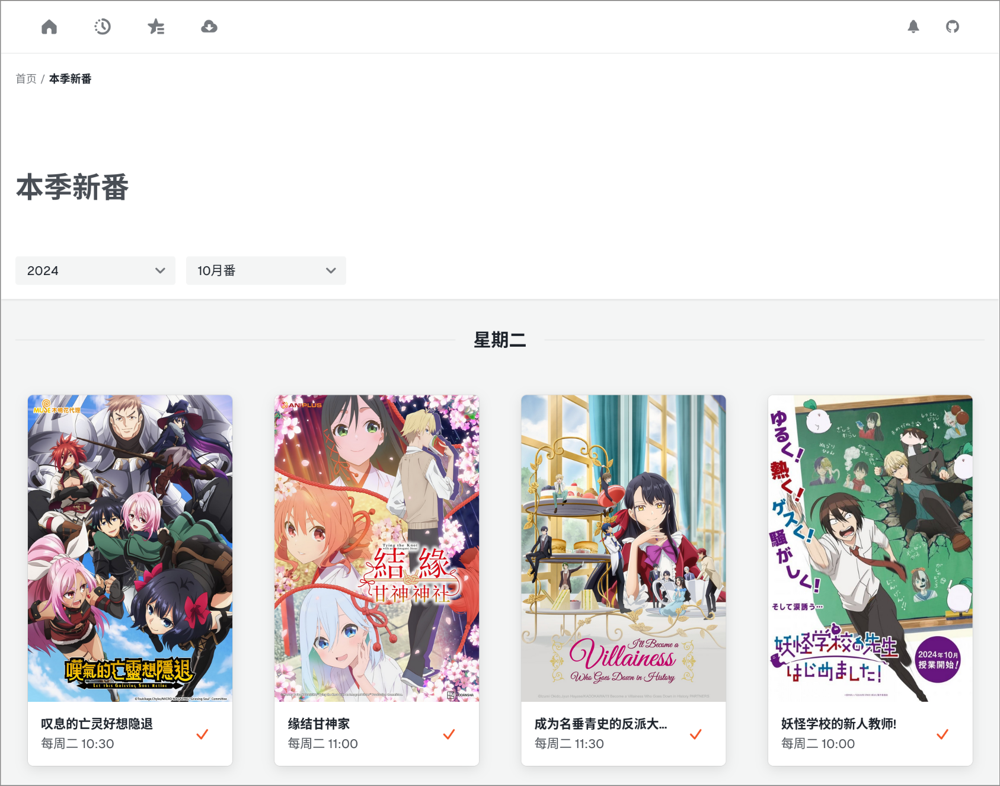
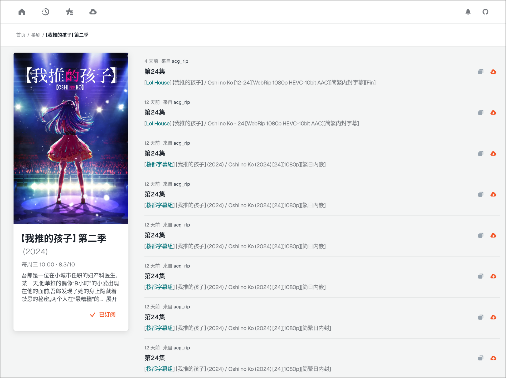

# Forrit

Bangumi tracker, subscription manager and downloader with an elegant web UI and robust backend server.

## Screenshots

 

## Installation

### Docker

A pre-built docker image is hosted on github registry. Pull the image with:

```sh
docker pull ghcr.io/george-miao/forrit:latest
```

### Nix Flake

You can use `github:George-Miao/forrit` as a flake to run `forrit`:

```sh
nix run 'github:George-Miao/forrit' -- $MY_CONFIG_PATH
```

Notice that `MY_CONFIG_PATH` is optional. If not provided, `forrit` under default [config path](https://docs.rs/dirs/latest/dirs/fn.config_dir.html) alone with environmental variables will be used to config forrit server.

Or you can also compose with your own system config:

```nix
{
  inputs.forrit.url = "github:George-Miao/forrit";
  outputs = { self, nixpkgs, forrit }:
    let
      # ... other items include initialize of nixpkgs
      settings = {
        http.bind = "0.0.0.0:80";
        # other forrit settings
      };
      cfg = builtins.toFile "forrit.json" (builtins.toJSON settings);
      forrit-server = forrit.forrit-server."${system}";
      forrit-module = {
        systemd.services.forrit-server = {
          description = "Bangumi tracker and downloader";
          requires = ["network-online.target"];
          wantedBy = ["multi-user.target"];
          script = "${forrit-server}/bin/forrit-server ${cfg}";
        };

        networking.firewall.allowedTCPPorts = [80];
      };
    in {
      nixosConfigurations.my-host = pkgs.lib.nixosSystem {
        modules = [
          forrit-module
          # Other modules
        ];
      };
    };
}
```

### Manual

1. Clone the repository and enter its root directory.
2. Run `nix develop` to install the development tools.
3. Run `build_frontend` if you need to regenerate the bundled frontend.
4. Run `build_server`. The build writes `target/release/forrit-server`.

Run `menu` in the development shell to list project commands.

## Components

### Resolver

Uses [TMDB API](https://developers.themoviedb.org/3) and [bangumi-data](https://github.com/bangumi-data/bangumi-data) to index all bangumi's and build the database. Then extract and match episode info from torrent and filename received from sourcers.

### Sourcer

- [x] Any RSS feed that contains Bangumi updates (e.g. [Bangumi](https://bangumi.moe), [ACG.RIP](https://acg.rip) or [Mikan Project](https://mikanani.me))
- [x] [Nyaa](https://nyaa.si) RSS with configurable category and startup history fetching

### Dispatcher

Manages subscription related operations. Received update from sourcers and send it to downloader if it's subscribed.

### Notifier

TODO

### Downloader

- [x] QbitTorrent
- [ ] Transmission
- [ ] aria2
- [ ] rqbit (?)

### Frontend

The `frontend` package is a Remix + Vite app styled with Semi UI. It uses the OpenAPI-generated `forrit-client` SDK to talk to the backend, rendering the seasonal schedule landing page, entry feed, subscription management view, and download job list. The build output is embedded into the server when the `webui` feature is enabled.

## TODO

- [x] (Frontend) Download job page
- [x] (Frontend) Entry detail page
- [ ] (Frontend) Fix wrong matching (entry - meta) and create alias for the fix
- [ ] (Frontend) Manually override season info (meta)
- [x] (Server) RSS html Sanitization (w/ [ammonia](https://github.com/rust-ammonia/ammonia))
- [x] (Server) Read torrent info for better resolution and file size
- [ ] (Server) Transmission API
- [ ] (Server) Notifier (w/ [pling](https://github.com/EdJoPaTo/pling))
- [ ] (Server) Search
- [ ] (Server) Events

## License

MIT
